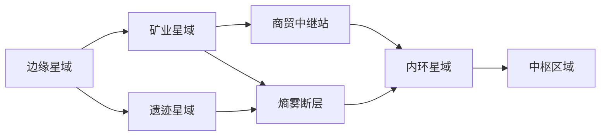
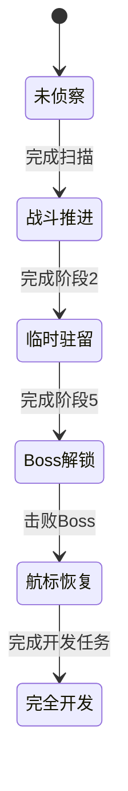

# 系统文档：星域地图与舰船航行（航网探索）

> 文档版本：v0.4  
> 文档类型：**规则（后 MVP 主形态）**；域内 M2 已落地，宇宙层为 M3+  
> **实现与验收状态**见 [PRODUCT-STATUS.md](PRODUCT-STATUS.md)；本文仅描述规则与设计标准。  
> 上级约束：`02-core-product-design.md`、`03-worldbuilding.md`  
> 关联：`13-region-and-ship.md`（区域战斗门）、`14-idle-and-offline.md`、`15-economy.md`、`16-market-and-card-trade.md`、`17-sector-and-onboarding.md`、`18-online-and-play-modes.md`、`21-fleet-factions-and-exploration.md`、**`23-procedural-universe-generation.md`（宇宙层生成管线）**、`22-ux-loop-and-ia.md`  
> 更新日期：2026-09-07  
> 变更：v0.4 每个星图节点从「一场战斗即通关」升级为短篇远征章节（§17）；v0.3 对齐程序生成航网（固定骨架 + 种子随机 + 验证器，见 `23`）；v0.2 拍板两层航网、五种通航状态、环带+网状路线。M2 域内雏形已按本文落地（见 §12.2）。

---

## 0. 核心规则（一句话）

> 宇宙由**星域节点**与**航线**连接构成。熵雾使大量节点失去定位、航线中断。玩家从**外缘星域**出发，通过扫描、战斗、生产、贸易和公共建设逐步**恢复航网**。越接近宇宙中心，熵雾、敌人、距离与补给压力越高，但资源、技术与断航情报也越珍贵。

**抵达中心是结果；让断裂的节点重新连接起来，才是持续发生的玩法。**

禁止把网状星图做成「换成蜘蛛网外观的线性关卡树」。

长期目标空间化：

> 玩家从宇宙边缘出生，在熵雾中逐渐恢复节点与航线；越接近中心，敌人、环境和物流压力越高，同时获得更稀有的资源与断航真相。

每个新星域的完整开拓循环：

```text
探测信号
→ 定位节点
→ 选择进入路线
→ 短篇远征（侦察 → 连续遭遇 → 区域机制 → 精英 → 补给 → Boss）
→ 修复航标
→ 建立采集与补给
→ 稳定航线
→ 自动物流
→ 向更深层扩张
```

**单个节点**不再等于「打赢一场战斗」。抵达之后是一条短篇远征：每场战斗揭示区域、提出新的阵容问题，并在 Boss 前制造一次调整阵容、生产装备或挂机积累的需求。重点不是机械增加战斗数量。标准流程见 §17。

战斗、生产和探索必须**同时**参与开图。Region 开战硬门（前置节点航标恢复 + 舰船门，见 `13`）仍然成立；本文管的是**如何看见、抵达、维持航道，以及节点内部如何推进**。

---

## 1. 目标与非目标

### 1.1 目标

1. **两层网络**：宇宙层只连星域；星域层才连星球与地点。  
2. **熵雾是空间状态**，不是灰色锁图标。  
3. **路线有策略差**：军事 / 工业 / 商贸 / 裂隙可交汇，不锁死职业。  
4. **环带控制进度，网状提供横向**：推荐远征等级，允许越级但付代价。  
5. **航线是可升级资产**：从未知路径到自动物流。  
6. **虫洞是特殊边**，不是另一套地图系统。  
7. 保留 M1 已落地的「舰船有坐标、雷达揭示、巡航耗时」（见 §12）。  
8. **节点是短篇远征，不是单场副本**：每场战斗改变节点状态；中途可挂机；Boss 通关才恢复航标并解锁相邻航线。

### 1.2 非目标

- 实时 3D 飞行、手操躲避  
- 开放世界同屏抢点 PvP（Online 仍用位面，见 `18`）  
- 用航行取消 Region 战斗门槛  
- MVP 一次做完全宇宙航网（第七前沿仍是外缘试点）  
- 把所有星球与所有星域画在同一张网上  

### 1.3 原则

| 原则 | 做法 |
| --- | --- |
| 开图 = 恢复航网 | 扫描→定位→通航→补给→自动物流 |
| 选择有意义 | 四条路线策略差；短路高风险 |
| 中心是远征检验 | 敌人+熵雾+距离+情报+资源五维，不是纯 HP |
| 后方仍有价值 | 软衰退（效率下降），不频繁锁回已通航线 |
| 可读 | 宇宙层只显示星域；默认隐藏低价值点；图层过滤 |

---

## 2. 两层网络

不要把所有星域和所有星球放在同一张网里。节点数量会失控，也无法阅读。

### 2.1 宇宙航网（星域之间）

每个**节点**是一整个星域；每条**边**是跨星域航道。



宇宙层承担：

- 长期进度与前往中心的**路线选择**；  
- 星域资源比较优势；  
- 玩家公共航线与跨星域贸易；  
- 虫洞、隐藏捷径。

### 2.2 星域星图（星球与地点之间）

进入星域后，再显示内部网络：恒星、行星、空间站、资源带、遗迹、熵雾异常、星域航标、跨星域出口。星域内部形成自己的小型非线性探索。

| 层级 | 节点 | 边 | 玩法权威 |
| --- | --- | --- | --- |
| 宇宙航网 | 星域 | 跨域航道 / 虫洞 | 本文 §2–§9 |
| 星域星图 | 天体 / 兴趣点 | 域内航道 | 雷达/巡航（§12）+ Region（`13`/`17`） |
| 地点内容 | Region / 节点远征 | — | 短篇远征（§17）+ 采集 / 驻留挂机 |

**与现 MVP：** 第七前沿 6 个 `regionId` 落在同一星域内部网上。线性前置可作「推荐航线」；物理上允许先扫到后区坐标，开战仍受 `13` 硬门限制。

---

## 3. 五种航网状态（「未解锁」≠ 上锁）

若熵雾区只是灰节点加一把锁，体验仍是「战力够了 → 点下一关」。熵雾必须是可调查、对抗和改变的空间状态。

| 状态 | 地图表现 | 玩家可以做什么 |
| --- | --- | --- |
| **未观测** | 完全隐藏 | 提升扫描、获取情报 |
| **熵雾覆盖** | 只显示模糊轮廓 | 探测信号、定位节点 |
| **已定位** | 显示节点与危险度 | 规划路线、派遣探针 |
| **临时通航** | 航道不稳定 | 冒险通过，承担额外成本 |
| **稳定通航** | 正常航线 | 自动航行、贸易和挂机 |

玩家不是「解锁一个星球」，而是在逐步恢复一段航网。

示例修复链：

1. 从边缘扫描到熵雾中的周期信号；  
2. 三角定位出未知航标；  
3. 派遣舰队清除附近敌人；  
4. 运输材料修复航标；  
5. 航标驱散局部熵雾；  
6. 显露后方多个节点和新路线；  
7. 建立长期补给线；  
8. 航线进入稳定通航。

Region / 节点远征状态（§17）描述**地点内部攻略**；上表描述**航网上的可见性与通行**。两者同时成立：可以已定位某星球，但仍因舰船门打不开远征；也可以打完前几场、已能挂机，但航标尚未恢复、相邻航线仍不稳定。

---

## 4. 中心难度：五个维度

「越靠近中心越难」正确；若只加敌人攻击和生命，会迅速退化成战力门槛。

| 难度维度 | 边缘 | 中环 | 中枢附近 |
| --- | --- | --- | --- |
| **敌人** | 单一阵容 | 机制组合 | 多阶段及动态克制 |
| **熵雾** | 轻微干扰 | 持续侵蚀 | 改变航行规则 |
| **距离** | 补给容易 | 需要中继站 | 长期远征 |
| **情报** | 位置明确 | 存在假信号 | 坐标与历史可能冲突 |
| **资源** | 常规资源 | 专业化资源 | 稀有但高风险 |

靠近中心后，挑战是**远征能力检验**：

- 舰员阵容能否解决敌人；  
- 工业体系能否持续补给；  
- 舰船能否承受环境；  
- 贸易网络能否补齐稀缺材料；  
- 玩家能否建设并维持航线。

这让新手卡牌、中期生产、后期贸易在中心远征中汇合。卡关区（`21` §2）是五维中的陡升节点，不是唯一难度手段。

**推荐远征等级**（软门，非绝对禁止）：

> 内环航线建议远征等级 32。当前舰队可以尝试，但熵雾侵蚀 +65%，无法使用自动返航。

高手可越级；普通玩家知道该继续准备什么。

---

## 5. 路线必须有策略差

网状的意义不是连线多，而是每条路代表不同发展策略。从边缘前往内环，例如：

| 路线 | 体验 | 收益 | 代价 |
| --- | --- | --- | --- |
| **军事** | 战斗频繁，航线较稳 | 武器蓝图 | 阵容要求高 |
| **工业** | 矿产丰富，建设多 | 长期生产优势 | 推进慢 |
| **商贸** | 多中转站，战斗少 | 信用、阵营关系 | 依赖市场 |
| **裂隙** | 虫洞与不稳定航道 | 秘境、稀有资源 | 短距、高随机 |

路线可重新交汇。玩家不是选职业后永远锁死，而是在不同阶段切换。

防止最短路径成为唯一答案：

- 核心航线需要不同工业条件；  
- 横向探索产出关键模块和蓝图；  
- 越短的路线风险越高；  
- 某些航线周期性中断；  
- 远路可能更稳、资源更好。

---

## 6. 环带 + 网状连接

纯随机网易杂乱。用**宇宙环带**控制整体进度，环带内部提供非线性。

| 环带 | 定位 | 主要内容 |
| --- | --- | --- |
| **外缘带** | 新手 | 卡牌、基础战斗、首次修复航标 |
| **开拓带** | 初期 | 采集、第一条生产线、多路线选择 |
| **断航带** | 中期 | 星域专业化、熵雾环境、远征补给 |
| **位面带** | 中后期 | 玩家交易、位面资源差、公共工程 |
| **内环带** | 后期 | 大型协作、复杂敌人、动态航道 |
| **中枢区** | 终局 | 断航真相与航网最终选择 |

环带**不是**固定章节墙。玩家可在环带内横向探索，也可冒险提前进入下一层（付 §4 软门代价）。

**宇宙层节点布局：** 环带层级与中心/终局锚点为**固定规则**；星域坐标、邻接、势力与资源填充为**种子驱动随机**，须通过 `23-procedural-universe-generation.md` 验证器。环带在视觉上可呈熵雾扭曲的不规则区域，而非绝对同心圆。

MVP：第七前沿落在**外缘带**（手工模板，见 `17`）；M3+ 展开开拓带及以远，并试点 §23 小型随机航网。

---

## 7. 出生扇区

玩家出生在网的边缘合理；不同玩家不应出生在完全等价的复制图，也不能因随机出生永久吃亏。

每位玩家（Online 每位面）出生在不同的**边缘扇区**，拥有一种比较优势：

| 出生扇区 | 优势 | 缺口 |
| --- | --- | --- |
| **富矿边境** | 金属丰富 | 能源不足 |
| **晶潮边境** | 能源材料丰富 | 舰体材料不足 |
| **生物边境** | 药剂和纤维丰富 | 重工业效率低 |
| **遗迹边境** | 蓝图和档案丰富 | 基础资源较少 |

所有出生点必须保证：

1. 基础材料可以自给；  
2. 第一条完整生产链可以建立；  
3. 能独立进入第二环带；  
4. 至少有一项适合出口的优势资源；  
5. **不存在明显最优出生区。**

主线所需能力须能通过自给、绕行或交易获得，禁止随机出「劣等宇宙」。

**生成契约（M3+）：** 出生扇区与位面比较优势由 `UniverseSeed` 驱动（主/次优势 + 缺口），基础保障资源不得缺失；公式与验证见 `23-procedural-universe-generation.md` §5。

玩家在外缘独立发展；进入**位面带**后才真正感到：我擅长别人缺少的东西，别人也拥有我需要的资源。与 `18` 位面偏置、`03` §9 对齐。

**Solo / MVP：** 固定第七前沿（可叙事为「开拓局试验投放」的富矿或平衡扇区），不随机出生；M3 起第二个星域或宇宙层试点接 `23`。

---

## 8. 航线是资产

连接线不能只是视觉线。每条航线记录：

| 字段 | 含义 |
| --- | --- |
| 稳定度 | 对应临时 / 稳定通航 |
| 航行时间 | 受距离、熵雾、中继影响 |
| 燃料消耗 | 巡航 / 跃迁成本 |
| 熵雾浓度 | 偏航、耐久、规则干扰 |
| 敌对活动 | 遭遇权重 |
| 运输容量 | 物流上限 |
| 中继站 | 是否可自动补给 |
| 自动运输 | 是否进入物流档 |
| 当前维护者 | 玩家 / 公会 / NPC |

升级链：

```text
未知路径
→ 临时航线
→ 稳定航线
→ 补给航线
→ 自动物流航线
→ 跨位面航线
```

建设反馈：原本一次危险远征，可以变成能自动运资源的成熟航道。自动化不只发生在工厂内部，而扩展到宇宙物流（与 `15` 流水线衔接，后 MVP）。

### 8.1 后方必须持续有价值

防止玩家只向中心冲、不经营已探索区：

- 后方提供稳定基础资源；  
- 设施和中继需要合理维护；  
- 新航线依赖旧航线补给；  
- NPC / 玩家订单改变区域需求；  
- 熵雾可**软衰退**未维护航道（降低运输效率），**禁止**频繁重新锁图。

---

## 9. 虫洞 = 航网中的特殊边

不单开一套虫洞地图。发现虫洞 = 星图上出现一条新边，直接改写原有路线。

| 虫洞类型 | 网络作用 |
| --- | --- |
| **稳定虫洞** | 连接两个遥远节点 |
| **单向虫洞** | 快速深入，无法原路返回 |
| **潮汐虫洞** | 周期性出现 |
| **漂移虫洞** | 出口在多个节点间变化 |
| **位面虫洞** | 连接其他玩家宇宙（Online） |
| **秘境裂隙** | 连接临时副本节点 |

战略选择（Online / 后 MVP）：公开坐标、卖给商盟、公会稳定并控制、保密自用、摧毁以阻止污染外溢。

与 `13` §10.1「虫洞随机跃迁」对齐：**失败回到跃迁原点**仍可作为单向/漂移虫洞的结算；发现本身应改变星图边，而不是只开宝箱。

探索度 >100% 事件池（`21` §6.3）是**发现**虫洞边的来源之一。

---

## 10. 节点数量与图层

每个节点都可点会迅速变成噪声。

- 宇宙层**只显示星域**；  
- 星域层才显示行星和兴趣点；  
- 默认隐藏低价值节点；  
- 提供资源 / 任务 / 危险 / 贸易图层；  
- 使用节点聚类与缩放层级。

部分星域可在不同玩家位面中偏移（丰度、某条航线被熵雾盖住、虫洞出口、遗迹保存度、事件），但须遵守 §7 的「无劣等宇宙」。偏移由 **UniverseSeed + 验证器** 保证可玩性，详见 `23` §1、§10。

---

## 11. 与 Region / 探索度的关系

```text
宇宙层选星域（航网状态 ≥ 已定位）
  → 进入星域星图
  → 巡航/跃迁抵达 body
  → 打开 Region 列表
  → CanEnter 仍用 13：前置 + 舰船门
```

**找路与维持航道**靠本文 §2–§10；**节点内部怎么打、何时能挂机**靠 §17；**开打硬门**靠战力与舰船建设（`13`）。

相邻航线的稳定通航以该节点 **航标恢复**（击败 Boss）为写入点，不以第一场普通战斗胜利为准。

星域探索度（`21` §6）表示对该星域内部世界的熟悉度，**提高**候选天体权重，**不替代**五种航网状态。建议对应：

| 探索度（域内） | 航网侧效果（建议） |
| --- | --- |
| 低 | 多为熵雾覆盖 / 已定位 |
| 50% | 主星与阵营商店；利于把域内干线推到临时通航 |
| 100% | Boss 入口；利于稳定通航 |
| >100% | 虫洞边、秘境裂隙事件 |

---

## 12. 当前实现（M1 保留 + M2 域内航网雏形）

宇宙航网（星域之间）仍为 **M3+**。第七前沿只做**星域内部**网。实现状态见 PRODUCT-STATUS。

### 12.1 M1 仍有效

| 项 | 规则 |
| --- | --- |
| 舰船坐标 | `navX/navY`；存档权威 |
| 雷达 | `radarRange` 由扫描模块推导；**移动才把未观测点刷成熵雾覆盖** |
| 巡航 Cruise | 域内移动；耗时随航道熵雾 / 临时通航 / 远征等级软门放大 |
| 跃迁 Jump | **M3**；不做跨域 |

### 12.2 M2 已落地（域内）

| 项 | 规则 |
| --- | --- |
| 五种状态 | 未观测/未解锁在地图上显示熵雾轮廓；已定位可规划航行；临时通航额外代价；稳定通航由修复航标或通关写入 |
| 内网边 | 军事 / 工业 / 商贸 / 裂隙四类航道，可交汇，不是线性关卡树 |
| 探测 | 雷达范围内或从已定位邻接边探测：熵雾覆盖 → 已定位 |
| 海图 | 停靠外缘港花费信用购买；揭示未观测为熵雾轮廓；主星（边境锚点）在探索度 50% 前不可被海图揭示 |
| 航标 | 停靠后可花费废料+信用修复；区域首通自动稳定该节点及相邻已定位边 |
| 软门 | 舰船等级低于推荐远征等级时，航行代价上升且提示无法自动返航（不禁止进入） |
| 探索度 | `explorationProgress` = 区域通关与航网恢复的加权；写入 `world.json` + 玩家档 |
| 缩放两层 | 连续平滑缩放+拖拽平移（类地图）；星域内缩小过临界点进入宇宙层，宇宙层只能点「进入星域」回到星域内。仅绘制已解锁节点及其相邻节点 |

### 12.2.1 P6 星图 UI（见 [22](22-ux-loop-and-ia.md)）

| 项 | 规则 |
| --- | --- |
| 布局 | 星图主体 **≥70%** 宽；节点列表收成可折叠导航日志；右侧仅目标面板 |
| 四轴展示 | 发现 / 航线 / 开发 / 舰队 — 组合文案，禁止混在一句话 |
| 节点视觉 | 未探测/熵雾用剪影或雾效，非完整行星立绘 |
| 图例 | 航线颜色图例（军事/工业/商贸/裂隙 + 通航 tier） |
| CTA | 按状态只显示合理操作；「购买星域海图」在扫描/情报区 |

雷达 / 海图公式（M2）：

```text
Unobserved → Fogged   if distance(ship, body) <= radarRange
                       OR (chart owned AND not capital-hub-before-50%)
Fogged     → Located  if Probe (in radar or located neighbor)
Located+   → sail allowed
dock / first sail     → Provisional node + incident edge
Repair beacon / clear → Stable
```

`knownBodyIds` 与 **已定位及以上** 同步，供旧逻辑读取。

### 12.3 航行时间与反时间墙

继承 `14`：航行写入 `TransitAction`；离线计入 credited 时间；允许材料/信用加速短途；禁止纯时间墙。航行中已启动的采集/制造可继续。M2 巡航仍为即时抵达 + ETA 展示（与 M1 相同）；乘数只影响显示与软门文案。

### 12.4 信标跃迁（M3）

跨星域阀门。标准跃迁消耗信标；盲跃高风险。经济上避免瞬间跳到中心高危带。与「临时通航承担额外成本」兼容。

---

## 13. 分阶段落地

| 阶段 | 交付 | 说明 |
| --- | --- | --- |
| **现况** | Region 战斗门 `13` | 开战硬门不变；节点内部仍是「一场即通关」 |
| **下一优先** | 节点远征样板（§17） | 先把「外缘港」做成 6 阶段完整样板，再决定是否扩到全图 |
| **M1** | 单星域 2D + 雷达 + 巡航 + 已探索列表 | 已实现（见 STATUS） |
| **M2** | 海图/中枢 + 域内航网状态雏形 | **部分实现**：五种状态 + 缩放两层 + 邻接解锁 + 探测/航标/海图；其他星域不可进入 |
| **M3** | 第二星域可玩 + 信标跃迁 + **小型随机航网试点** | 外缘→开拓带；15–20 星域 / 4 环带；见 `23` §12 |
| **M4** | 环带径向 + 航线升级 + 虫洞边 + **生成验证器** | 长线探索；推荐远征等级；局部修复坏图 |
| **M5+** | 完整宇宙生成 + 出生扇区 seed + 跨位面航线 | 依赖 Online `18`；秘境槽位动态激活 |

MVP 演示不阻塞于 M3+；语义以本文为准。

---

## 14. 数据模型（草案）

```text
UniverseConfig
- center, rings[]          // 环带（固定层级；节点坐标见 23）
- threatBands[]            // 五维基线，非仅等级
- universeSeed             // Hash(服务器+位面+赛季)；见 23 §2.1、06 §4.3.7

GridNode                  // 宇宙层：星域
- sectorId, ringId
- gridState                // 五种航网状态
- recommendedExpeditionLv

GridEdge                  // 宇宙层：航道 / 虫洞
- from, to
- edgeType: Lane|Wormhole…
- stability, transitTime, fuel, entropy, hostility
- capacity, hasRelay, autoLogistics
- maintainerId
- upgradeTier              // 未知→…→跨位面

SectorMap                 // 星域层
- bodies[], innerEdges[]
- hubBodyId, chartItemId

StellarBody
- bodyId, sectorId, x, y
- regionIds[]
- bodyType: Planet|Station|Belt|Relic|Beacon|Exit|Anomaly|Hub
- campaign?                // 可攻略节点才有；见 §17.9

ShipNavigationState       // M1 已部分落地
- x, y, radarRange
- unlockedCharts[], knownBodyIds[]
- transit?

BirthSector               // Online；Solo 固定第七前沿
- sectorAffinityId
- exportBias, importGap
```

服务方向：`NavigationService`（巡航）+ `GridService`（节点状态、边升级、海图、探测）。宇宙层 `GridService` 扩展为 M3；**生成**见 `UniverseGenerator`（`23` §11）。

---

## 15. UI

| 屏 | 内容 |
| --- | --- |
| 宇宙航网 | 星域节点、航道稳定度、环带、推荐远征等级；默认不画星球 |
| 星域星图 | 雷达圈、舰船、航标、出口、图层开关 |
| 航行 / 跃迁 | 时间、燃料、熵雾风险、是否可自动返航 |
| 航线面板 | 升级档位、维护、物流开关 |
| 地点点开 | 节点远征进度 + 当前关卡情报 + 条件 CTA（§17.4 / §17.8） |

---

## 16. 设计验收标准

- 玩家理解目标是**编织航网**，不是点下一关打到中心。  
- 宇宙层与星域层分离，不会在一张图上堆满星球。  
- 熵雾区可以探测与改变，而不是一把锁。  
- 至少能讲清四条策略路线的差异，且可交汇。  
- 越级走软门（侵蚀、禁自动返航），不绝对锁死。  
- 航线升级能把「危险远征」变成「自动物流」。  
- 后方软衰退，不频繁锁图。  
- M1：把船开过去；雷达决定看见什么。
- M2：熵雾可探测；航线可修复；海图不代替航行。
- 节点远征：玩家理解「这是一章短篇」，不是连打六次相同杂兵；打不过 Boss 时前面几场仍有收益；通关后不再逐关点击。

---

## 17. 节点远征章节

禁止把可攻略节点做成「一场战斗即通关」。每个节点是一条短篇远征：

```text
抵达节点 → 侦察 → 连续遭遇 → 发现节点机制 → 精英战 → 补给准备 → Boss战 → 建立航标 → 解锁挂机与相邻航线
```

目标不是堆战斗次数，而是让每场战斗逐步揭示区域、提出新的阵容问题，并在 Boss 前产生一次调整阵容、生产装备或挂机积累的需求。

舰船门与相邻节点前置仍由 `13` 裁定。本节管节点**内部**进度、奖励、挂机分层和 UI。

### 17.1 单节点标准流程

首版验证采用「5 场普通/精英 + 1 场 Boss」。以外缘港（`sec01_outer_belt` 的星图节点）为样板：

| 阶段 | 内容 | 设计作用 | 首次奖励 |
| --- | --- | --- | --- |
| 1. 航道接触 | 2–3 个基础敌人 | 展示区域敌人和环境机制 | 信用点、角色战斗经验 |
| 2. 残骸搜索 | 敌人数量增加 | 解锁该节点第一处挂机产地 | 铁矿、情报数据 |
| 3. 护航遭遇 | 敌人攻击后排或运输船 | 引导玩家调整站位或战术 | 招募券碎片、材料 |
| 4. 熵雾伏击 | 加入区域环境效果 | 暴露舰船或阵容短板 | 抗熵材料、扫描经验 |
| 5. 精英封锁 | 精英敌人，接近 Boss 机制 | 检验玩家是否准备完成 | Boss 情报、临时增益 |
| 6. Boss：劫掠旗舰 | 完整机制战 | 完成节点主线目标 | 招募券、蓝图、航标核心 |

节奏：第一场让玩家理解，第二、三场建立收益，第四、五场制造阻力，第六场提供高潮。禁止做成连续六次相同杂兵。

### 17.2 节点状态机

节点通关不再只有「未通关 / 已通关」。



| `NodeCampaignState` | 含义 | 玩家可以做什么 |
| --- | --- | --- |
| `Unscouted` 未侦察 | 只能看到异常信号和大致坐标 | 扫描、探测；不能开战 |
| `Advancing` 正在攻略 | 显示战斗进度和当前关卡 | 继续当前阶段；阶段 2 起可部分挂机 |
| `Staging` 临时驻留 | 可挂机采集基础资源，航线仍不稳定 | 挂机 / 继续攻略 / 调整舰队；相邻航线未解锁 |
| `BossReady` Boss 已发现 | 允许挑战 Boss | Boss 必须单独确认，禁止自动连打 |
| `BeaconRestored` 航标恢复 | 节点主线通关 | 解锁相邻航线；节点合并为驻留挂机目的地 |
| `Developed` 完全开发 | 开发任务完成 | 最高挂机效率、贸易或生产设施 |

与航网五种状态的关系：

- `Unscouted` 对应航网「熵雾覆盖 / 已定位」之前的地点内容。  
- `Staging` 不把航线写成稳定通航。  
- `BeaconRestored` 才写入该节点及相邻已定位边的稳定通航（与 §12.2 航标规则对齐）。  
- 旧 `RegionProgressState.Cleared` 映射为 `BeaconRestored`；旧「一场主挑战胜利」不再等于通关。

即使暂时打不过 Boss，阶段 2 之后的挂机与材料仍有效，前面的战斗不是空转。

### 17.3 按节点难度调整关卡数量

不要所有节点都固定 6 场，否则后期节奏会机械。

| 节点等级 | 普通战斗 | 精英战 | Boss | 总战斗数 | 建议体验时长 |
| --- | ---: | ---: | ---: | ---: | ---: |
| 外缘普通节点 | 4 | 1 | 1 | 6 | 5–8 分钟 |
| 边境节点 | 5–6 | 1 | 1 | 7–8 | 8–12 分钟 |
| 中层危险节点 | 6–7 | 2 | 1 | 9–10 | 12–18 分钟 |
| 深层核心节点 | 7–9 | 2 | 1–2 阶段 | 10–12 | 15–25 分钟 |
| 秘境 / 虫洞 | 3–7 随机 | 0–2 | 1 | 5–10 | 不确定 |

「体验时长」指玩家实际决策与首次推进时间，不包括挂机等待。

后期 Boss 可分为两个阶段，但不要做成两个完全独立的 Boss 关卡。例如：第一阶段摧毁旗舰护盾 → 中途允许一次战术调整 → 第二阶段攻击旗舰核心。

第七前沿首版：外缘港按外缘普通节点（6 场）制作样板；矿脉支线、护航航道等在样板验收后再套用对应档。

### 17.4 战斗进度在 UI 中的表现

当前节点详情右侧有足够空间。在节点名称与说明下方增加一条「节点战役进度」。

#### 视觉规则

只用颜色不够，必须同时用大小、形状、图标和边框区分。

| 状态 | 表现 |
| --- | --- |
| 尚未解锁 | 小号灰色空心圆点 |
| 可挑战 | 小号黄色空心圆点 |
| 已完成 | 小号黄色实心圆点，内部带勾 |
| 正在挑战 | 放大黄色实心圆点 + 外圈呼吸动画 |
| 精英战 | 中号橙色菱形或带尖角圆点 |
| Boss 关 | 大号红色实心圆点 + 红色外圆环 + Boss 图标 |
| Boss 已完成 | 红色圆点变暗，内部显示勾，外圈改为金色 |
| 失败过 | 圆点下方显示小型失败标记，不改变关卡状态色 |

#### 尺寸

| 元素 | 尺寸 |
| --- | --- |
| 普通关卡 | 12–14 px |
| 当前关卡 | 20–22 px |
| 精英关卡 | 18 px |
| Boss 核心 | 24–28 px |
| Boss 外圈 | 36–40 px |
| 圆点连接线 | 2 px；已完成黄色，未完成暗灰 |

#### 右侧面板结构

```text
外缘港                         攻略进度 3/6

● —— ● —— ◉ —— ○ —— ◆ —— ⦿
1     2     3     4     5    Boss
完成  完成  当前   锁定  精英   劫掠旗舰

熵雾伏击
推荐战力：12,800
敌人特征：优先攻击后排
环境影响：每3回合降低舰船护盾

[调整舰队]             [开始挑战]
```

符号仅用于文档示意：`●` 已完成，`◉` 当前，`○` 未完成，`◆` 精英，`⦿` Boss。实际 UI 使用圆形组件和图标，不使用这些文本符号。

节点说明改为**当前关卡情报**：敌人机制、环境效果、预计收益。不要只重复节点世界观长文。

### 17.5 星图节点本身不要直接展示全部圆点

若所有星球在星图上都画 6–12 个圆点，地图会迅速杂乱。分两级显示。

**缩放较小时（默认星图）：**

- 节点图标外侧一圈攻略进度；  
- 黄色圆环表示普通战斗进度；  
- 红色缺口表示 Boss 尚未击败；  
- 中心显示 `3/6`；  
- 正在攻略的节点外框轻微闪烁；  
- 外缘港完成 3/6 时，外圈填充约 50%。

**选中节点或放大地图时：**

才展开完整关卡序列。可从星球图标向右展开短链：

```text
星球图标 — ● — ● — ◉ — ○ — ◆ — Boss
```

右侧详情同步当前关卡信息。地图上能看到进度，但整张航网不被圆点淹没。

### 17.6 Boss 不能只是数值更高

每个节点有一个贯穿多场战斗的**区域机制**；Boss 负责综合检验。玩家应在前几战分别见过 Boss 的能力，最终只需把学到的内容组合起来，禁止毫无预警的机制杀。

外缘港区域机制：**航道劫掠**。

| 阶段 | 机制揭示 |
| --- | --- |
| 1 | 普通劫掠艇 |
| 2 | 敌人开始攻击货舱 |
| 3 | 高速艇绕过前排 |
| 4 | 熵雾降低命中 |
| 5 | 精英指挥舰为其他单位提供护盾 |
| Boss | 劫掠旗舰同时拥有后排突袭、护盾和熵雾干扰 |

其他节点主题（与 `17-sector-and-onboarding.md` 区域表对齐，供后续编排）：

| 节点 | 区域机制 | Boss 考题 |
| --- | --- | --- |
| 外缘港 | 航道劫掠 | 后排保护 + 护盾 + 熵雾 |
| 矿脉支线 | 高护甲机械敌人 | 破甲能力 |
| 护航航道 | 敌人攻击运输目标 | 控制、保护和快速击杀 |
| 量子裂隙 | 技能目标发生偏移 | 扫描、命中和稳定模块 |
| 不稳定虫洞 | 敌人随机增援 | 持续作战和续航 |
| 深渊边界 | 熵雾持续侵蚀 | 抗熵模块和补给能力 |
| 边境锚点 | 复合威胁 | 多机制组合（深层核心档） |

### 17.7 自然加入挂机积累

不要求玩家连续打完 6 场。应在中间主动制造短暂停顿。

推荐节奏：

1. 完成战斗 1；  
2. 可自动连续挑战战斗 2；  
3. 战斗 2 后解锁基础挂机；  
4. 战斗 3 暴露阵容短板；  
5. 玩家可以继续尝试，也可以挂机积累；  
6. 用产出制造装备或升级舰船；  
7. 完成战斗 4、精英战 5；  
8. 解锁 Boss；  
9. Boss 通关后开启该节点完整挂机收益。

挂机收益分阶段开放（以 6 阶段节点为例）：

| 攻略进度 | 节点功能 |
| --- | --- |
| 0/6 | 无法挂机 |
| 2/6 | 基础材料挂机，效率 40% |
| 3/6 | 解锁战斗挂机，效率 60% |
| 5/6 | 解锁稀有材料小概率掉落 |
| 6/6（航标恢复） | 效率 100%，开放完整掉落池 |
| 完全开发 | 效率 120% 或增加并行任务 |

挂机不是通关硬门槛，而是打不过时自然出现的成长方案。采集节点在阶段 2 即可启动（覆盖 `14` 旧「必须区域通关」）。战斗挂机在阶段 3 开放，掉落按**已完成最高战斗阶段**计算。

已明显碾压的普通关卡可以自动连续推进：

> 自动推进开启：预估胜率高于 90% 时，战斗结束后自动进入下一场；遇到精英、Boss、失败或舰船损伤过高时停止。

Boss 必须单独确认，防止准备不足时自动消耗资源。

### 17.8 首次通关与重复挂机分开

加入多场战斗后，必须防止玩家每天重新逐关点击。

| 阶段 | 操作模型 |
| --- | --- |
| 首次攻略 | 按战斗阶段推进 |
| Boss 通关后 | 整个节点合并为一个挂机目的地 |
| 难度选择 | 选择挂机难度，而不是重新选择 1–6 关 |
| 掉落 | 按已完成最高战斗阶段计算 |
| 普通战斗 | 不可重复领取首次奖励 |
| Boss | 可周期性重启，作为悬赏或高难挑战，不阻碍航线 |

右侧按钮：

| 节点状态 | 主按钮 | 次按钮 | 工具 |
| --- | --- | --- | --- |
| 正在攻略 | `继续攻略 3/6` | `部署挂机`（阶段 ≥2） | `调整舰队` |
| 航标恢复 / 完全开发 | `驻留挂机` | — | `调整舰队`、`查看战斗记录` |
| Boss 周期性重启 | 不替代主按钮 | `高难悬赏` | — |

废止「重新挑战 / 挂机刷取 / 采集」三并列作为已通关节点的默认主操作。已通关节点不再逐关点击。

### 17.9 数据结构

关卡不必为每个节点完全手工配置。用模板组合：区域模板决定环境和敌人池；难度模板决定战斗数量与成长曲线；节点类型决定奖励；Boss 模板决定最终机制；少量关键节点手工编排。

```text
StarNodeCampaign
- nodeId
- regionId
- difficultyTier           // Outer | Frontier | Mid | Deep | Mystery
- battleStages[]
- currentStage
- nodeState                // NodeCampaignState
- regionModifier
- idleRewardTier           // 0 / 0.4 / 0.6 / 1.0 / 1.2
- highestClearedStage
- bossDefeated
- developmentLevel

BattleStage
- stageId
- stageType: Normal | Elite | Boss
- enemyGroupId
- recommendedPower
- firstClearRewards
- unlockRequirements
- narrativeEventId
- idleUnlock               // None | Gather | Combat | RareDrop | Full
```

存档写在 `world.json` 的节点进度下，不另开平行存档。`13` 的 `RegionConfig.mainEncounterId` 在样板落地后降为「当前阶段遭遇」的兼容读取，新内容以 `battleStages[]` 为准。

### 17.10 当前页面的直接修改清单

针对现有 Explore 右侧目标面板与星图节点图标：

| 改动 | 健康度 | 说明 |
| --- | --- | --- |
| 节点名称下增加战役进度条 | 必要 | 显示已完成、当前、精英和 Boss |
| 「重新挑战」改为「继续攻略 3/6」 | 必要 | 明确下一步及当前进度 |
| 通关后收起逐关操作 | 必要 | 主按钮改为「驻留挂机」 |
| 星球图标增加进度环 | 推荐 | 未选中也能看到攻略程度 |
| 节点说明改为当前关卡情报 | 推荐 | 敌人机制、环境、预计收益 |
| 2/6 后开放部分挂机 | 良好 | 避免必须一次打完，并连接生产 |
| Boss 大红点 + 外圈 + 专属图标 | 良好 | 必须兼顾形状和文字，不能只依赖红色 |

首版验证：外缘港按「5 场普通/精英 + 1 场 Boss、第二战开放基础挂机、第五战解锁 Boss、Boss 通关恢复航标」落地。样板验收后再扩展到全图。

---

## 18. 开放问题

1. 驾驶是否占用一支卡组，或仅锁舰船？  
2. 盲跃 / 临时通航的偏航与额外成本公式？  
3. 海图永久解锁 vs 消耗品？（建议永久）  
4. Solo 是否在 M4 前暴露宇宙层，还是仅用星域内网模拟五种状态？  
5. 航线维护者在 Solo 是否仅为玩家 + NPC 开拓局？  
6. 外缘港样板验收后，第七前沿其余 5 区是一次改成远征章节，还是按环带逐步替换？  
7. 「完全开发」任务是节点内短链，还是复用星港 / 工业订单？  

---

## 19. 参考

- `03-worldbuilding.md`（断航 / 熵雾 / 中枢选择）  
- `13-region-and-ship.md`、`17-sector-and-onboarding.md`  
- `14-idle-and-offline.md`、`15-economy.md`、`16-market-and-card-trade.md`  
- `18-online-and-play-modes.md`、`21-fleet-factions-and-exploration.md`  
- `22-ux-loop-and-ia.md`（星图右侧 CTA）  
- **`23-procedural-universe-generation.md`**（种子生成、验证器、位面比较优势）  
- 舰船模块：`mod_scanner` / `mod_propulsion` / `mod_reactor` / `mod_entropy`
